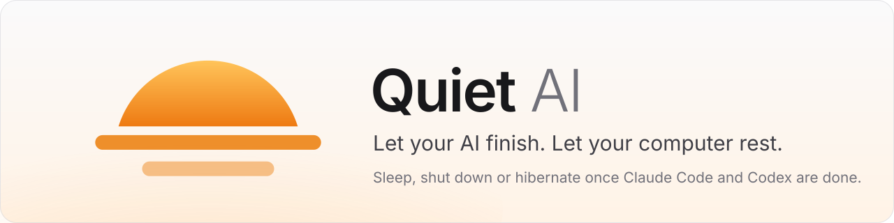
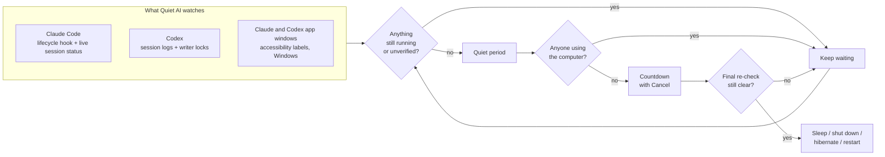

<p align="center">
  <picture>
    <source media="(prefers-color-scheme: dark)" srcset="docs/images/banner-dark.svg">
    
  </picture>
</p>

<p align="center">
  <a href="https://github.com/Nikita-Shulga/QuietAI/releases/latest"></a>
  <a href="https://github.com/Nikita-Shulga/QuietAI/releases"></a>
  <a href="https://github.com/Nikita-Shulga/QuietAI/actions/workflows/build.yml"></a>
  
  <a href="LICENSE"></a>
</p>

<p align="center">
  <b><a href="https://github.com/Nikita-Shulga/QuietAI/releases/latest">Download</a></b> ·
  <a href="#how-it-works">How it works</a> ·
  <a href="#faq">FAQ</a> ·
  <a href="docs/DETECTION.md">Detection details</a> ·
  <a href="CHANGELOG.md">Changelog</a>
</p>

---

You start a long **Claude Code** or **Codex** run before bed, or before you leave. You don't want the computer on all night, and you can't shut it down halfway through.

**Quiet AI waits until every prompt has finished, waits a little longer to be sure, gives you a countdown to cancel, and then sleeps, shuts down, hibernates or restarts the computer.** If it can't verify that something is finished, it keeps waiting.

<p align="center">
  <picture>
    <source media="(prefers-color-scheme: dark)" srcset="docs/images/Overview.png">
    
  </picture>
</p>

## Features

|  |  |
| --- | --- |
| 🧠 **Knows when your AI is done** | Tracks every local **Claude Code** session (desktop app, terminal, VS Code) and every **Codex** chat (app, terminal, IDE), including subagents and background tasks. Each running chat is listed by name with how long it has been running. |
| 🛡️ **Errs on the side of waiting** | It acts only after a quiet period and a cancellable countdown. Anything it can't verify keeps the plan waiting; silence is never taken as "done". |
| 🙋 **Never acts while you're using the PC** | It waits until nobody has touched the mouse or keyboard for a while (10 minutes by default). Any input during the countdown cancels it. The countdown shows as a banner on every screen. |
| ⏻ **Your choice of action** | Windows: sleep, shut down, hibernate, restart, lock. macOS: sleep, shut down, restart, display sleep. Or use **timer mode**: "shut down in 90 minutes". |
| ☕ **Keeps the PC awake while armed** | The computer can't doze off in the middle of the work it's waiting for. |
| 🔄 **One-click updates** | Settings → About → **Update now** downloads the latest release from GitHub, verifies its checksum and restarts into it. Your settings are kept. |
| 🔒 **Private by design** | No account, no API key, no telemetry. Prompt and response text are never read or stored. The only network request is the update check against this repository's releases. |
| 🌗 **Feels native** | Light and dark themes, tray icon with live status, keyboard shortcuts (<kbd>Enter</kbd> to arm, <kbd>Esc</kbd> to stop). |

## Download

| System | Package | Notes |
| --- | --- | --- |
| **Windows 10 / 11** (Intel/AMD) | `QuietAI-<version>-win-x64.zip` | Recommended |
| Windows on ARM | `QuietAI-<version>-win-arm64.zip` | |
| macOS 14+ (Apple silicon) | `QuietAI-<version>-mac-arm64.zip` | Tested on macOS 15, see [docs/MAC.md](docs/MAC.md) |
| macOS 14+ (Intel) | `QuietAI-<version>-mac-x64.zip` | Preview |

Get them from the **[latest release](https://github.com/Nikita-Shulga/QuietAI/releases/latest)**. Each release also has `SHA256SUMS.txt` for verifying the downloads.

**Windows:** extract the **whole** ZIP somewhere you can write to (for example `C:\Apps\QuietAI` or your Documents folder), then run `QuietAI.exe`. Nothing else needs to be installed. The app isn't code-signed yet, so SmartScreen may warn you the first time: click **More info → Run anyway**.

**macOS:** extract with Archive Utility, move **Quiet AI.app** to **Applications**, then open it. The Mac builds are ad hoc signed, not notarized, so the first launch needs **System Settings → Privacy & Security → Open Anyway**. Details in [docs/MAC.md](docs/MAC.md).

## Quick start

1. **Open Quiet AI.** It finds your Codex and Claude folders automatically.
2. **Connect Claude Code** (Settings → Claude Code → **Connect**, once). This adds a small lifecycle hook to Claude Code's `settings.json`. The file is backed up first and your other hooks are kept. **Test** checks it; **Disconnect** removes it.
3. **Pick what happens:** *After AI finishes* or *On a timer*, then the action, the quiet period and the time to cancel.
4. Press **Start monitoring** and walk away.

> [!TIP]
> Restart Claude Code sessions that were already open when you connected, so they load the hook. Quiet AI still sees them in the meantime through Claude Code's live session status.

## How it works



| Source | How it's read | What it covers |
| --- | --- | --- |
| **Claude Code** | Official [lifecycle hooks](https://code.claude.com/docs/en/hooks) feed a tiny local collector (session, prompt and agent IDs only), plus the live status Claude Code keeps for each running session (`busy` / `waiting` / `idle`) | Prompts, permission prompts, subagents, background tasks and scheduled wakeups, in the desktop app, terminal or IDE |
| **Codex** | Live session writer locks and turn start/complete events in the session logs, read without touching Codex's files | Chats in the Codex app, CLI and IDE |
| **App windows** (Windows) | Windows UI Automation, the accessibility API screen readers use. Only button and status labels such as **Stop** and **Running** | Extra safety net for what the Claude and Codex apps show on screen |

Every detail, edge case and known limit is written down in **[docs/DETECTION.md](docs/DETECTION.md)**.

## FAQ

<details>
<summary><b>Will it shut down while Claude is waiting for my permission?</b></summary>

No. A Claude Code session that's waiting for permission or input counts as still running, because the work can't finish until someone answers.
</details>

<details>
<summary><b>What about Claude Chat, Cowork, or Codex cloud tasks?</b></summary>

Those run on Anthropic's or OpenAI's servers and keep going when your computer sleeps or shuts down, so Quiet AI doesn't need to wait for them. If the Claude or Codex app happens to show one running on screen, Quiet AI still waits for it.
</details>

<details>
<summary><b>What if I'm still at the computer when the AI finishes?</b></summary>

With **Wait until I'm away** on (the default), nothing happens until there has been no mouse or keyboard input for the time you set. Moving the mouse during the countdown cancels it, and the plan keeps waiting for you to step away.
</details>

<details>
<summary><b>Does it read my prompts or code?</b></summary>

No. The Claude collector stores only IDs, event names, timestamps and the working directory. The Codex reader keeps offsets, IDs and statuses. The window watcher reads only button and status labels. Nothing leaves your computer.
</details>

<details>
<summary><b>Why does Windows say the app is from an unknown publisher?</b></summary>

The app isn't code-signed yet. You can check each download against `SHA256SUMS.txt` in the release, or [build it yourself](#build-from-source).
</details>

<details>
<summary><b>How do updates work?</b></summary>

Quiet AI checks this repository's latest GitHub Release when it starts and every 6 hours. Settings → About → **Update now** downloads your platform's ZIP, verifies it against the release's `SHA256SUMS.txt`, swaps the files and restarts. Updating is refused while a plan is armed.
</details>

<details>
<summary><b>Something kept the plan waiting all night. How do I find out why?</b></summary>

Quiet AI keeps a small activity log (`%LOCALAPPDATA%\CodexQuietShutdown\quietai-activity.log` on Windows) of what the plan was waiting for each minute. It contains no chat content. Settings → About → **Copy status summary** gives a redacted summary to paste into a [bug report](https://github.com/Nikita-Shulga/QuietAI/issues/new/choose).
</details>

## Build from source

You need Python 3 and the [.NET 10 SDK](https://dotnet.microsoft.com/download). There are no npm dependencies.

```sh
git clone https://github.com/Nikita-Shulga/QuietAI.git
cd QuietAI
python scripts/build.py win-x64        # or win-arm64; mac-arm64 / mac-x64 on a Mac
```

The script downloads the pinned Electron build and verifies its SHA-256, builds the self-contained .NET monitor, brands the app and writes a portable ZIP to `.artifacts/releases/`. Add `--repo owner/name` to point a local build's updater at your fork.

To work on the interface with sample data and no monitor or power actions, run an Electron 44 binary with `electron desktop --preview`.

### Project layout

```
desktop/     Electron app: main process, sandboxed UI, updater, window watcher, power actions
src/         .NET monitor: Codex and Claude Code detection, Claude hook installer
hooks/       Claude Code hook collector (Windows)
scripts/     build.py (packaging), icons.py (app icon)
tests/e2e/   end-to-end UI tests with a fake monitor and a recording power module
docs/        detection spec, UI notes, macOS notes, release process
```

### Releasing

Bump the version in `desktop/package.json` and `scripts/build.py`, add a section to `CHANGELOG.md`, then push a tag such as `v4.2.1`. GitHub Actions builds all four packages and publishes the release, and every installed copy offers the update. See [docs/RELEASING.md](docs/RELEASING.md).

## Contributing

Bug reports, ideas and pull requests are welcome. Start with **[CONTRIBUTING.md](CONTRIBUTING.md)**. It explains how the pieces fit together and the one rule detection changes must keep: *when in doubt, wait.*

- 🐞 [Report a bug](https://github.com/Nikita-Shulga/QuietAI/issues/new?template=bug_report.yml)
- 💡 [Suggest a feature](https://github.com/Nikita-Shulga/QuietAI/issues/new?template=feature_request.yml)
- 🔐 [Report a vulnerability privately](https://github.com/Nikita-Shulga/QuietAI/security/advisories/new)

Please follow the [Code of Conduct](CODE_OF_CONDUCT.md). For questions, see [SUPPORT.md](SUPPORT.md).

## License

[MIT](LICENSE) © 2026 [Nikita Shulga](https://nikitashulga.com)

Electron and the .NET runtime keep their own licenses, which ship in `licenses/` inside every release. The Inter typeface is used under the SIL Open Font License. The Claude and Codex icons aren't included: Quiet AI reads them from your own installed apps at runtime.

<sub>Quiet AI is an independent project, not affiliated with or endorsed by Anthropic, OpenAI, Microsoft or Apple. Claude is a trademark of Anthropic; Codex and ChatGPT are trademarks of OpenAI.</sub>
