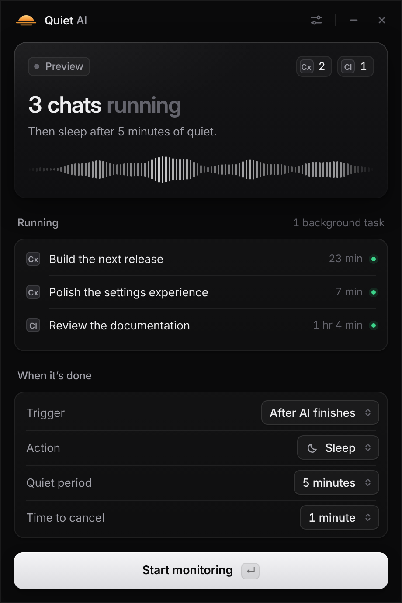
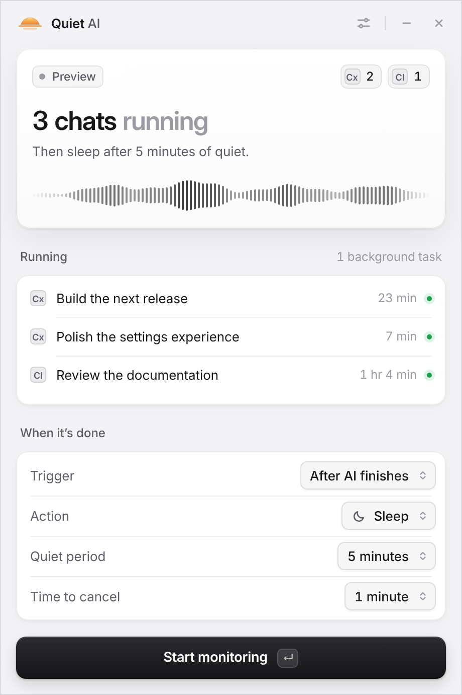

<p align="center">
  
</p>

<h1 align="center">Quiet AI</h1>

<p align="center"><b>Let your AI finish. Let your computer rest.</b><br>
Quiet AI watches your Claude and Codex prompts, then puts your PC to sleep, shuts it down, restarts or hibernates it once all of them have finished.</p>

<p align="center">
  <a href="../../releases/latest">Download</a> ·
  <a href="docs/DETECTION.md">How detection works</a> ·
  <a href="CHANGELOG.md">Changelog</a> ·
  <a href="https://nikitashulga.com">nikitashulga.com</a>
</p>

| Dark | Light |
| --- | --- |
|  |  |

## Why

You start a long agent run before bed or before you leave. You don't want the PC on all night, and you can't shut it down halfway through. Quiet AI waits until every chat is done, waits a little longer to be sure, gives you a countdown to cancel, and then runs the action you picked.

## Features

- **Tracks running prompts wherever they run:**
  - Codex sessions and Claude Code sessions, local or terminal;
  - anything visible in the Claude and Codex desktop apps on Windows (Chat, Cowork, Code, local or cloud).
- **Lists each running chat by name**, with its provider icon and how long it has been running.
- **Waits safely.** Before acting, it confirms a quiet period, then gives you a cancellable countdown. Anything it can't verify keeps it waiting; silence is never taken as "done".
- **Never acts under you.** It also waits until nobody has touched the mouse or keyboard for a while (10 minutes by default), and any input during the countdown cancels it. The countdown appears as a banner on top of everything, on every screen.
- **Power actions:**
  - Windows: sleep, shut down, hibernate, restart, lock.
  - macOS: sleep, shut down, restart, display sleep.
- **Timer mode:** "shut down in 90 minutes", independent of AI activity.
- **Keeps the PC awake while a plan is armed**, so it can't doze off mid-task. When the countdown starts, the window comes forward and you get a notification.
- **Lives in the tray.** Minimize it and it sits in the notification area; hover for the status, click to open, right-click to stop the plan.
- **Light and dark themes**, following the system or pinned in Settings. Uses the real Claude and Codex icons from your installed apps.
- **Fully local.** No account, no API key, no telemetry and no network port. Chat content is never read or stored. The only network use is checking this project's GitHub Releases for a new version.
- **One-click updates.** Settings → About → Update now downloads the new version from GitHub Releases, verifies its checksum and restarts into it. Your settings are kept.

## Install

### Windows 10 / 11

1. Download `QuietAI-<version>-win-x64.zip` from [Releases](../../releases/latest). Use `win-arm64` for Windows on ARM.
2. Extract the **whole** ZIP anywhere, for example `C:\Apps\QuietAI`.
3. Run `QuietAI.exe`. Nothing else needs to be installed.

Windows SmartScreen may warn you because the app isn't code-signed. Click **More info → Run anyway**.

### macOS (preview)

macOS builds are produced by CI, but they are ad hoc signed, not notarized, and haven't been tested much. See [docs/MAC.md](docs/MAC.md).

## Use

1. Open **Settings** (sliders icon, top right). Quiet AI finds the Codex and Claude folders automatically.
2. *Optional:* click **Connect Claude Code** to track Claude Code sessions run from a terminal. Quiet AI backs up your Claude `settings.json` and leaves your other hooks alone. **Test** checks the connection, and **Disconnect** removes it.
3. Choose **After AI finishes** or **On a timer**, then pick the action, quiet period and countdown.
4. Press **Start monitoring** (Enter). **Esc** stops the plan or cancels the countdown.

Keep Quiet AI open while a plan is armed. Closing it cancels the plan, and the app asks you first.

## How it knows something is running

| Source | Signal |
| --- | --- |
| Codex | Live session writer locks, plus turn start and complete events in the session logs |
| Claude Code | Claude Code's official lifecycle hooks: a tiny local collector records session and prompt IDs, never prompt text |
| Claude & Codex apps (Windows) | Windows UI Automation (the accessibility API). Reads only activity markers such as Claude's **Stop response** button and its **Running ‹chat›** sidebar entries, and Codex's **Stop** button and **Working** markers |

Full details and limits: [docs/DETECTION.md](docs/DETECTION.md).

## Build from source

Requirements: Python 3 and the [.NET 10 SDK](https://dotnet.microsoft.com/download). No npm packages are needed.

```sh
python scripts/build.py win-x64        # also: win-arm64, mac-arm64, mac-x64 (on a Mac)
```

The script:

- downloads the pinned Electron 44.7.0 and verifies its SHA-256;
- builds the self-contained .NET monitor;
- sets the app icon;
- writes a portable ZIP to `.artifacts/releases/`.

To run the UI in place for development, without the monitor or any power action, use an Electron 44 binary:

```sh
electron desktop --preview
```

### Releases

Push a version tag. GitHub Actions builds every platform and attaches the ZIPs and SHA-256 checksums to a GitHub Release:

```sh
git tag v4.1.0
git push origin v4.1.0
```

### Tests

`tests/e2e` drives the real app in Electron with a fake monitor and a power module that only records what it was asked to do. **No real sleep or shutdown ever happens.** See [tests/e2e/README.md](tests/e2e/README.md).

## Project layout

```
desktop/   Electron app (main process, sandboxed renderer, window watcher, power actions)
src/       .NET monitor: Codex and Claude Code detection, Claude hook installer
hooks/     Claude Code hook collector (Windows)
scripts/   build.py (packaging), icons.py (app icon)
tests/e2e/ end-to-end UI tests
docs/      detection, UI, macOS and release notes
```

## Privacy

Everything stays on your computer:

- The renderer has no Node or filesystem access.
- The monitor talks to the app over stdio, not the network.
- The Claude collector discards prompt, response and tool text.
- The window watcher reads only button and status labels.

Settings live in `%LOCALAPPDATA%\QuietAI` on Windows and `~/Library/Application Support/Quiet AI` on macOS.

## License

[MIT](LICENSE) © 2026 [Nikita Shulga](https://nikitashulga.com).

Bundled third-party components:

- Electron and the .NET runtime keep their own licenses (shipped in `licenses/` in each release).
- The Inter typeface uses the SIL Open Font License.

The Claude and Codex icons are not included: they are read from your own installed apps at runtime.

Quiet AI is an independent project. It is not affiliated with or endorsed by Anthropic, OpenAI, Microsoft or Apple. Claude is a trademark of Anthropic, and Codex and ChatGPT are trademarks of OpenAI.
